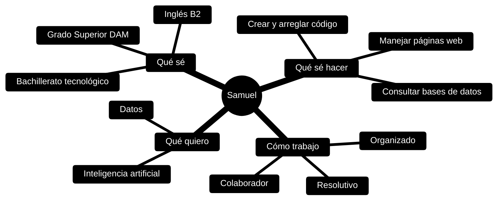
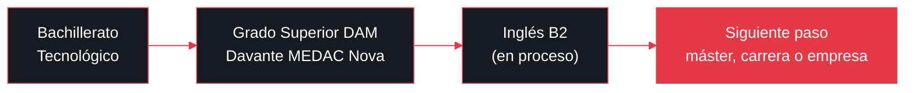

 

## 👨‍💻 Sobre mí

Soy Samuel, de Málaga. Estoy terminando el ciclo de Desarrollo de Aplicaciones Multiplataforma (DAM) en Davante MEDAC Nova y preparándome para obtener el B2 de inglés. Anteriormente cursé Bachillerato Tecnológico.

Lo que más me gusta del desarrollo es todo lo relacionado con los datos: diseñar una base de datos, realizar consultas y conseguir que una aplicación trabaje correctamente con ella. Cuando algo no funciona, intento encontrar el error y buscar una solución. Al principio puedo necesitar algo de tiempo para adaptarme a un entorno nuevo, pero una vez que me ubico trabajo con orden y me gusta colaborar.

A medio plazo me gustaría trabajar en el ámbito de los datos y, si surge la oportunidad, acercarme también a la inteligencia artificial. Actualmente busco mi primera oportunidad profesional, tanto en modalidad presencial como híbrida.

## 🧩 Mi perfil de un vistazo

## 🛠️ Tecnologías y herramientas

**Lenguajes de programación y desarrollo web**

  

**Bases de datos**

  
   
  
  

**Herramientas**

  

Estas son algunas de las tecnologías y herramientas que he utilizado durante mi formación. Sigo ampliando mis conocimientos y experiencia con ellas.

## 🌍 Idiomas

  
  

## 🚀 Proyectos

<table>
  <tr>
    <td align="center">
      <h3>🔧 Próximo proyecto</h3>
      Espacio reservado para añadir un nuevo proyecto cuando esté terminado.
    </td>
  </tr>
</table>

## 📚 Formación

- Grado Superior en Desarrollo de Aplicaciones Multiplataforma (DAM), Davante MEDAC Nova.
- Bachillerato Tecnológico.
- Cursos de OpenWebinars: Java, SQL y Git.

## 🌱 Qué estoy mejorando

Quiero seguir ampliando mis conocimientos mediante nuevos cursos y proyectos prácticos. También estoy trabajando en mejorar mi disciplina y mi capacidad para adaptarme a situaciones y entornos nuevos.

## 📊 Estadísticas de GitHub

  
  
   
  
   
  

## 📬 Contacto

¿Quieres contactar conmigo o conocer mis proyectos?

📧 **Correo:** [marquezlavadosamuel@gmail.com](mailto:marquezlavadosamuel@gmail.com)

💼 **LinkedIn:** [Mi perfil profesional](https://www.linkedin.com/in/samuel-m%C3%A1rquez-lavado-413916399)

💻 **GitHub:** [github.com/smarlav](https://github.com/smarlav)

   
  
  Gracias por visitar mi perfil. Siempre aprendiendo y mejorando.

